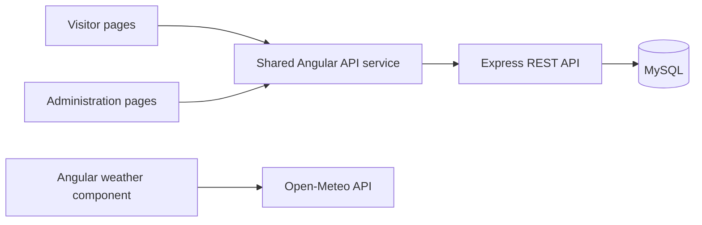

# HopeBridge Charity Events

A full-stack charity event platform built with Angular, Express and MySQL. HopeBridge connects event discovery and registration with an administrative workspace for managing events and reviewing participation.

[Live demo](https://24833183.it.scu.edu.au/) · [Search events](https://24833183.it.scu.edu.au/search) · [Administration](https://24833183.it.scu.edu.au/admin/events)

Developed for **PROG2002 Web Development II, Assessment 3**. All event records, organisations, contacts and fundraising figures are fictional. Ticket registration records a pledge; the application does not collect payments.

## Contents

- [Features](#features)
- [Architecture](#architecture)
- [Getting started](#getting-started)
- [Database](#database)
- [API reference](#api-reference)
- [Development and testing](#development-and-testing)
- [Deployment](#deployment)
- [Limitations and security](#limitations-and-security)
- [Project context](#project-context)

## Features

### Visitor experience

- Browse public events and filter by date, location and category.
- View event details, charity information, fundraising totals and recent registrations.
- Register for an upcoming event, choose 1–10 tickets and receive a confirmation number.
- Check event-day weather from Open-Meteo for dates from today through 15 days ahead.
- Use responsive pages with loading, empty, validation and error states.

### Event administration

- View all events, including upcoming, past and suspended records.
- Create and update events, including their venue timezone, coordinates and ticket price.
- Review registration contacts, ticket quantities and contributions.
- Delete events that have no registrations; existing registrations block deletion.

### Data handling

- Parameterised SQL queries and a shared MySQL connection pool.
- One registration per email address per event, enforced by a unique database constraint.
- Registration transactions lock the event row and capture the ticket price at registration time.
- Venue timezone conversion for determining whether registration has closed.
- Public registration responses omit email and phone fields. Administrative endpoints return full contact details; see [security limitations](#limitations-and-security).

## Architecture

The visitor and administrative interfaces share one Angular application. Express provides the REST API and serves the compiled application in production. The weather component requests forecasts directly from Open-Meteo.



| Layer | Technology |
| --- | --- |
| Frontend | Angular 22, TypeScript 6, RxJS, Reactive Forms |
| Styling | Custom CSS and Lucide icons |
| API | Node.js, Express 4, `mysql2` |
| Database | MySQL; MySQL 8 recommended for local development |
| Weather | Open-Meteo forecast API |
| Tests | Angular unit tests and Node.js test runner |

```text
src/app/
  pages/                 Visitor and administration pages
  core/                  API service, models, navigation and helpers
  shared/                Date input, event cards, icons and weather
public/assets/           Images and other public assets
server/
  controllers/           Queries, registration transactions and event CRUD
  routes/                REST endpoint definitions
  event_db.js            MySQL connection pool
  event-time.js          Venue-time conversion
  validation.js          Server-side input validation
  tests/                 Validation and database/API tests
database/                Schema, seed data and migration scripts
app.js                   Production startup entry point
```

## Getting started

### Prerequisites

- Node.js **24.15.0 or later within 24.x**, with npm. The root manifest records npm 11.17.0.
- A running MySQL server, preferably MySQL 8 for local development.
- Git and a database client such as MySQL Workbench or the MySQL CLI.

Run the following commands from the repository root unless stated otherwise.

### 1. Install dependencies

```bash
git clone https://github.com/TheLegenDK100/WEB2A3.git
cd WEB2A3
npm ci
```

### 2. Initialise the database

Open `database/charityevents_a3.sql` in your database client and execute it against your local MySQL server. It creates or selects `charityevents_db`, then recreates the four project tables and loads fictional seed data.

> **Existing data:** this script drops the project tables. Use a disposable local database or back up existing records before importing. Alternative installation and migration scripts are described under [Database](#database).

### 3. Configure the environment

Copy `.env.example` to `.env` and replace the example values with your local database settings.

PowerShell:

```powershell
Copy-Item .env.example .env
```

macOS / Linux:

```bash
cp .env.example .env
```

```dotenv
DB_HOST=localhost
DB_PORT=3306
DB_USER=your_database_user
DB_PASSWORD=your_database_password
DB_NAME=charityevents_db
PORT=3070
```

Keep `.env` local. Use separate credentials for development and hosting.

### 4. Start the application

Start the API in one terminal:

```bash
npm run start:api
```

Start the frontend in a second terminal:

```bash
npm start
```

Open [http://localhost:4200](http://localhost:4200). The Angular development proxy forwards `/api` requests to `http://127.0.0.1:3070`. If you change the API port, update `proxy.conf.json` to match.

The API checks its database connection before listening. Check a running server at [http://localhost:3070/api/health](http://localhost:3070/api/health). A healthy response contains `"status": "ok"` and `"database": "connected"`.

## Database

The seed dataset contains **3 organisations, 4 categories, 10 events and 12 registrations**. Two events are suspended and excluded from the public API.

| Script | Purpose |
| --- | --- |
| `database/charityevents_a3.sql` | Complete local schema and seed data; resets the project tables. |
| `database/cpanel_first_install.sql` | First installation into an empty database selected in phpMyAdmin; does not create or select a database. |
| `database/cpanel_import.sql` | Reset and reseed the project tables in the selected cPanel database. |
| `database/upgrade_from_a2.sql` | One-time migration from the expected A2 schema. |
| `database/upgrade_event_timezones.sql` | Add timezone support to an older A3 schema that does not yet have the column. |

Choose the script for your current schema; do not run all scripts in sequence. Both the full A3 schema and the A2 migration already include the timezone column.

`charity_events` references an organisation and a category. `event_registrations` references an event with `ON DELETE RESTRICT`, and `UNIQUE (event_id, email)` prevents duplicate registrations for the same email and event. Monetary columns use `DECIMAL`; each registration stores its own ticket-price snapshot. Fundraising totals combine recorded progress with ticket quantities multiplied by those stored prices.

Event dates are stored as venue-local `DATETIME` values alongside an IANA timezone. New registrations are timestamped in UTC. The API exposes a UTC event instant for status checks and returns registration lists newest first.

## API reference

All endpoints are relative to the application origin and use the `/api` prefix. POST and PUT requests accept JSON with `Content-Type: application/json`.

| Method | Endpoint | Description |
| --- | --- | --- |
| GET | `/api/health` | Check API and database availability. |
| GET | `/api/events` | List public, non-suspended events. |
| GET | `/api/events/search` | Filter public events by `date`, `location` and/or `category`. |
| GET | `/api/events/:id` | Retrieve an event and its public registration list. |
| GET | `/api/categories` | List event categories. |
| GET | `/api/organisations` | List charitable organisations. |
| POST | `/api/registrations` | Register an email address for an event. |
| GET | `/api/admin/events` | List all events, including suspended records. |
| GET | `/api/admin/events/:id` | Retrieve an event and complete registration contacts. |
| POST | `/api/admin/events` | Create an event. |
| PUT | `/api/admin/events/:id` | Update an event. |
| DELETE | `/api/admin/events/:id` | Delete an event with no registrations. |

Example filtered request:

```http
GET /api/events/search?date=2026-10-24&location=Brisbane&category=2
```

Successful creation returns `201`. Handled errors use a JSON `error` field, with `400` for invalid input, `404` for unavailable resources and `409` for conflicts such as duplicate registration or deletion of an event with registrations. Database request failures return `500`; a failed database health check returns `503`. See [known limitations](#limitations-and-security) for current validation gaps.

## Development and testing

| Command | Purpose |
| --- | --- |
| `npm start` | Start the Angular development server with the API proxy. |
| `npm run start:api` | Start the Express API; also serves an existing frontend build. |
| `npm run dev` | Alias for starting the API only; does not start Angular. |
| `npm run build` | Create the production frontend build. |
| `npm run watch` | Rebuild the frontend in development mode when files change. |
| `npm test -- --watch=false` | Run Angular unit tests once. |
| `node --test server/tests/validation.test.js` | Run standalone backend validation tests without MySQL. |
| `npm run test:api` | Run backend validation tests and the database/API integration suite. |

The integration suite creates and drops a temporary database using the configured MySQL account. Run it locally with the required database-creation permissions, not with a restricted hosting account.

The registration integration test uses a seeded event scheduled for **24 October 2026 at 19:00, Australia/Brisbane**. Its successful-registration expectation becomes invalid after that time; move the test fixture into the future before relying on later runs.

### Recorded verification

During review on **18 October 2026**, the three standalone backend validation tests passed. Read-only checks of the hosted application confirmed database connectivity, the expected event and registration counts, combined search, suspended-event filtering and event-detail weather rendering.

The full database/API suite, Angular tests and production build were not rerun during the repository import. These observations describe that review date; they are not a current CI result or a claim that every edge case is covered.

## Deployment

### Local production preview

```bash
npm run build
node app.js
```

Open [http://localhost:3070](http://localhost:3070). Express serves `dist/hopebridge-a3/browser` and the API from the same origin, with fallback routing for Angular pages. The generated `dist/` directory is excluded from Git.

### SCU cPanel

1. Build locally with Node.js 24.15.0 or later within 24.x using `npm ci` and `npm run build`.
2. Create a database in cPanel. Select it in phpMyAdmin and import `database/cpanel_first_install.sql` for an empty installation.
3. Create a dedicated application database user with SELECT, INSERT, UPDATE and DELETE permissions. Configure credentials privately in the deployed application root or cPanel environment settings.
4. Upload `app.js`, `server/` and `dist/hopebridge-a3/browser`. Exclude local credentials, dependencies, caches and database backups.
5. In the **deployment copy only**, place `server/package.json` and `server/package-lock.json` at the application root as `package.json` and `package-lock.json`. This backend-only dependency set supports Node.js 18 and later; keep the Angular manifests in the source checkout.
6. Configure a production Node.js application with startup file `app.js`, run NPM Install and restart it.
7. Verify `/api/health`, public pages, registration and administrative workflows. Also test direct navigation and refresh on nested routes.

The current application assumes deployment at the domain root. A subdirectory deployment requires changes to the Angular base URL and API configuration.

The supplied hosting notes report Node.js 18.20.8 and MySQL 5.7.44; those control-panel settings were not independently rechecked during the import. MySQL 5.7 does not enforce `CHECK` constraints, so server-side validation remains necessary alongside foreign keys, unique keys and `NOT NULL` constraints.

## Limitations and security

This is an assessment application using fictional data. Administrative routes and APIs have **no authentication**. Omitting contacts from public responses does not protect them from access through administrative endpoints. Add authentication and authorisation before using real participant data or operating the service publicly beyond the assessment scope.

The current snapshot has these known technical issues:

- **Date error handling:** some unsupported years can throw during conversion before the controller's error handler runs. Asynchronous route errors need consistent handling.
- **Phone validation:** punctuation-only input can pass the current client and server patterns.
- **Search validation:** date input with trailing content can pass the truncated timestamp check.
- **Image validation:** path format is checked, but file existence is not; invalid selections can produce broken images.
- **Weather mapping:** Open-Meteo codes 85 and 86 are currently labelled as thunderstorms instead of snow showers.

Local environment files are excluded from the current tracked source. An earlier commit contained `.env`; removing it from the latest revision does not erase history. Rotate any real credentials that were committed.

## Project context

This repository uses **modern Angular**, not AngularJS 1.x. Any assessment criterion specifically naming AngularJS requires clarification with the lecturer.

The existing application was imported on 18 October 2026. That commit records a source snapshot, not the original development timeline. Future commits should describe actual changes and their validation.

Each team member's cPanel deployment, demonstration video and confidential peer evaluation are separate assessment deliverables. Only one hosted URL is documented here; this README does not establish that the remaining submission evidence is complete.
